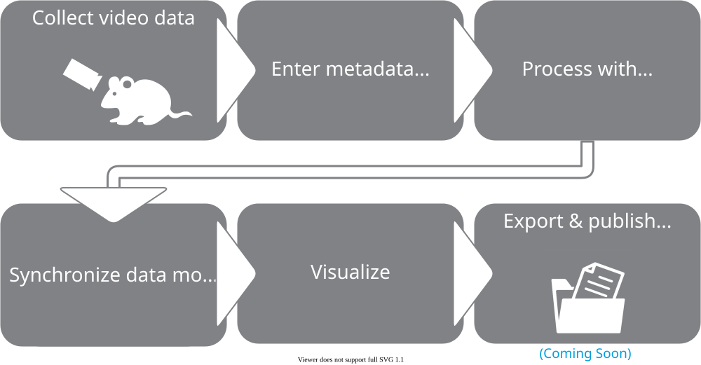
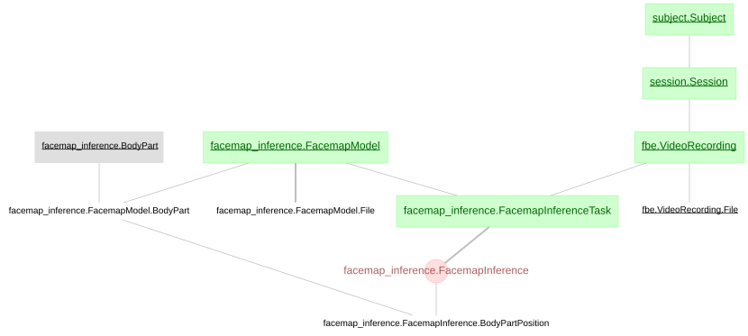

> ## ⚠️ This is the `datajoint-2.x` branch of a fork
>
> Unofficial fork of [`datajoint/element-facemap`](https://github.com/datajoint/element-facemap),
> ported to **DataJoint 2.x**. Not affiliated with DataJoint. See
> [why this branch exists](#why-this-branch-exists) at the bottom.

# DataJoint Element for orofacial motion tracking with Facemap

DataJoint Element for modeling neural activity based on orofacial tracking using [Facemap](https://github.com/MouseLand/facemap). This Element supports facemap analysis using distinct keypoints on the mouse face, and computing the singular value decomposition and pupil tracking. 

DataJoint Elements collectively standardize and automate data collection and analysis for neuroscience experiments. Each Element is a modular pipeline for data storage and processing with corresponding database tables that can be combined with other Elements to assemble a fully functional pipeline. This repository also provides a tutorial environment and notebooks to learn the pipeline.

## Experiment Flowchart



## Data Pipeline Diagram



+ We have designed two variations of the pipeline for different use cases. Displayed above is the pipeline for the `facemap_inference` schema. Details on the pipeline for `facial_behavior_estimation` can be found in the [Data Pipeline](https://docs.datajoint.com/elements/element-facemap/latest/pipeline/)

## Getting Started

+ Please fork this repository.

+ Clone the repository to your computer

    ```bash
    git clone https://github.com/<enter_github_username>/element-facemap.git
    ```

+ Install with `pip`
    
    ```bash
    pip install -e .
    ```

+ [Interactive tutorial on GitHub Codespaces](https://github.com/datajoint/element-facemap#interactive-tutorial)

+ [Documentation](https://docs.datajoint.com/elements/element-facemap/)

## Support

+ If you need help getting started or run into any errors, please open a GitHub Issue or contact our team by email at support@datajoint.com.

## Interactive Tutorial

+ The easiest way to learn about DataJoint Elements is to use the tutorial notebooks within the included interactive environment configured using [Dev Container](https://containers.dev/).

### Launch Environment

Here are some options that provide a great experience:

+ (*recommended*) Cloud-based Environment
  + Launch using [GitHub Codespaces](https://github.com/features/codespaces) using the `+` option which will `Create codespace on main` in the codebase repository on your fork with default options. For more control, see the `...` where you may create `New with options...`.
  + Build time for a codespace is a few minutes. This is done infrequently and cached for convenience.
  + Start time for a codespace is less than 1 minute. This will pull the built codespace from cache when you need it.
  + *Tip*: Each month, GitHub renews a [free-tier](https://docs.github.com/en/billing/managing-billing-for-github-codespaces/about-billing-for-github-codespaces#monthly-included-storage-and-core-hours-for-personal-accounts) quota of compute and storage. Typically we run into the storage limits before anything else since Codespaces consume storage while stopped. It is best to delete Codespaces when not actively in use and recreate when needed. We'll soon be creating prebuilds to avoid larger build times. Once any portion of your quota is reached, you will need to wait for it to be reset at the end of your cycle or add billing info to your GitHub account to handle overages.
  + *Tip*: GitHub auto names the codespace but you can rename the codespace so that it is easier to identify later.

+ Local Environment
  > *Note: Access to example data is currently limited to MacOS and Linux due to the s3fs utility. Windows users are recommended to use the above environment.*
  + Install [Git](https://git-scm.com/book/en/v2/Getting-Started-Installing-Git)
  + Install [Docker](https://docs.docker.com/get-docker/)
  + Install [VSCode](https://code.visualstudio.com/)
  + Install the VSCode [Dev Containers extension](https://marketplace.visualstudio.com/items?itemName=ms-vscode-remote.remote-containers)
  + `git clone` the codebase repository and open it in VSCode
  + Use the `Dev Containers extension` to `Reopen in Container` (More info is in the `Getting started` included with the extension.)

You will know your environment has finished loading once you either see a terminal open related to `Running postStartCommand` with a final message of `Done` or the `README.md` is opened in `Preview`.

Once the environment has launched, please run the following command in the terminal:
```
MYSQL_VER=8.0 docker compose -f docker-compose-db.yaml up --build -d
```

### Instructions

1. We recommend you start by navigating to the `notebooks` directory on the left panel and go through the `tutorial.ipynb` Jupyter notebook. Execute the cells in the notebook to begin your walkthrough of the tutorial.

2. Once you are done, see the options available to you in the menu in the bottom-left corner. For example, in Codespace you will have an option to `Stop Current Codespace` but when running Dev Container on your own machine the equivalent option is `Reopen folder locally`. By default, GitHub will also automatically stop the Codespace after 30 minutes of inactivity.  Once the Codespace is no longer being used, we recommend deleting the Codespace.


---

## Why this branch exists

Upstream `element-facemap` was last committed on 2025-05-20 and targets DataJoint
`>=0.13`. DataJoint **2.0.0** shipped 2026-02-03 as a self-described complete
rewrite; the current release is 2.3.2. Because the element's dependency pin
admits 2.x, `pip install element-facemap` on a fresh environment today resolves
DataJoint 2.x and produces an installation in which the element cannot be
imported. No element had a 2.x branch and there was no open migration issue or
PR anywhere in the `datajoint` org when this fork was created.

**This branch is the complete migration, not a backward-compatible subset.**
An earlier version of this fork split the work into a `compat-fixes` branch
(changes that also work on 0.14.x) and this `datajoint-2.x` branch (adding the
2.x-only changes on top). The upstream maintainer's guidance, after reviewing
that split, was not to ship it that way: a schema is either 2.x or pre-2.x,
DataJoint no longer supports pre-2.x, and landing the backward-compatible
subset alone is actively harmful here -- it clears the import error while
leaving any `longblob`/`attach` attributes in place, which silently corrupts
data instead of loudly failing to import. See
[the migration guide](https://docs.datajoint.com/how-to/migrate-to-v20/) for
the authoritative type mapping and phase structure this follows (this is
Phase I: code only, against empty schemas, no production data touched).

Both `compat-fixes` and `datajoint-2.x` now point at the same commit and carry
the same content, kept as two names only so nothing that already referenced
either one breaks.

### Full scope of this branch

| change | count |
|---|---|
| `dj.schema` -> `dj.Schema` | 2 |
| `longblob` -> `<blob>` | 16 |
| `attach` -> `<attach>` | 1 |
| `smallint`/`int` -> `int16`/`int32` | 13 |
| `float` -> `float32` | 4 |
| `setup.py`: `datajoint>=0.13.0` -> `datajoint>=2.3` | — |

`attach` has the same problem as `longblob`: 0.14.9 rejects the 2.x spelling (`<attach>`) and 2.x rejects the legacy one, so it needed its own fix rather than falling out of the `longblob` regex.

The correctness bugs in `FacialSignal` (component-axis mixup, an empty `motSv` raising `IndexError`, `MovieSVD` never actually populating) are **not** part of this branch. They are unrelated to DataJoint version and are being fixed as their own PR -- see the separate issue on the upstream repo.

### The `longblob` change is not cosmetic

Under DataJoint 2.x a `longblob` attribute is a **raw native column**. It
declares without error and the insert succeeds, but a numpy array written to
it comes back as `bytes`:

```
longblob   (as this element declared it)   -> returned type: bytes     round-trip OK: False
<blob>     (the 2.x codec)                 -> returned type: ndarray   round-trip OK: True
```

Nothing raises. There is no warning beyond a generic "consider a core
DataJoint type" notice at declaration time that says nothing about data loss.
Traced upstream in datajoint/datajoint-python#1527: PyMySQL has no encoder for
`np.ndarray` and silently falls back to `str(value)`; the same declaration on
PostgreSQL raises instead of corrupting. See
[datajoint/element-facemap#45](https://github.com/datajoint/element-facemap/issues/45)
for the full round-trip evidence.

### Using it

```
pip install git+https://github.com/akshay-jaggi/element-facemap.git@datajoint-2.x
```

Pin the commit rather than the branch name if you need reproducibility. Every
change was applied mechanically (regex over each table's `definition` string,
scoped so it cannot touch a docstring or a function signature) and then
reviewed line by line; no element behaviour was altered, only attribute-type
spellings that 2.x renamed, replaced, or requires as core types.

Open PR: [datajoint/element-facemap#44](https://github.com/datajoint/element-facemap/pull/44).
